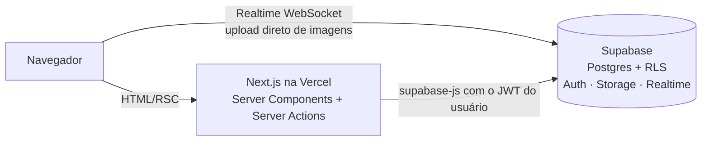
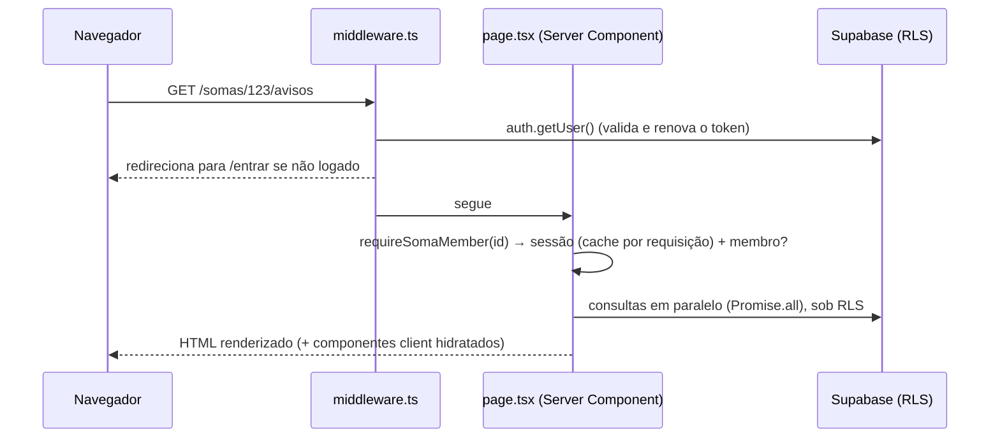
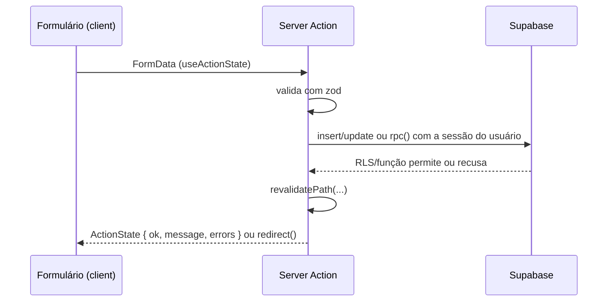
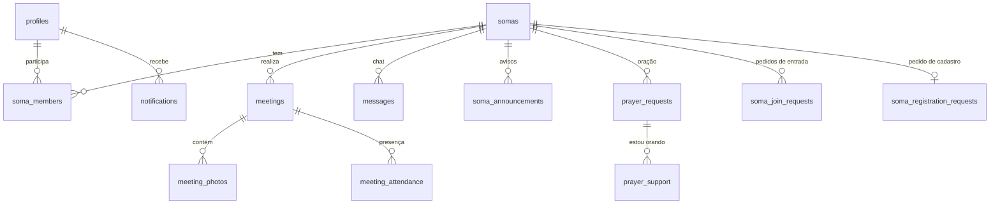
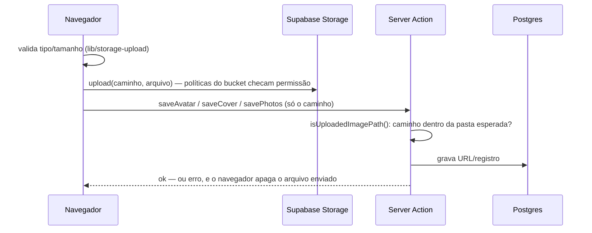

# Arquitetura — SOMA Conecta

Documento de referência para entender como o projeto está organizado, quais padrões ele segue e onde mexer ao implementar algo novo.

> **Resumo em uma frase:** aplicação **Next.js 15 (App Router)** renderizada no servidor, sem API própria, que fala direto com o **Supabase** (Postgres + Auth + Storage + Realtime). Toda regra de segurança vive no **banco** (RLS + funções `security definer`); a aplicação é uma camada fina de interface e validação.

---

## Sumário

1. [Visão geral](#1-visão-geral)
2. [Stack](#2-stack)
3. [Estrutura de pastas](#3-estrutura-de-pastas)
4. [Fluxo de uma requisição](#4-fluxo-de-uma-requisição)
5. [Autenticação e autorização](#5-autenticação-e-autorização)
6. [Banco de dados](#6-banco-de-dados)
7. [Padrões da aplicação](#7-padrões-da-aplicação)
8. [Funcionalidades e onde estão](#8-funcionalidades-e-onde-estão)
9. [Tempo real (Realtime)](#9-tempo-real-realtime)
10. [Upload de imagens (Storage)](#10-upload-de-imagens-storage)
11. [Notificações e contadores](#11-notificações-e-contadores)
12. [Privacidade e LGPD](#12-privacidade-e-lgpd)
13. [Performance](#13-performance)
14. [Ambiente, deploy e migrações](#14-ambiente-deploy-e-migrações)
15. [Guia: como adicionar uma funcionalidade](#15-guia-como-adicionar-uma-funcionalidade)
16. [Convenções](#16-convenções)

---

## 1. Visão geral

O SOMA Conecta organiza pequenos grupos (os **SOMAs**): busca de grupos, pedido de entrada, encontros com presença e fotos, chat, avisos do responsável, pedidos de oração e um painel administrativo.



Pontos-chave da arquitetura:

- **Sem backend próprio.** Não há rotas de API REST. As páginas leem dados em **Server Components** e as escritas acontecem em **Server Actions** — ambos usando o cliente Supabase **com a sessão do usuário** (nunca com a service key).
- **O banco é a fonte de verdade da segurança.** Mesmo que a interface esconda um botão, quem decide se a ação é permitida é a **RLS** (Row Level Security) ou uma **função SQL**. O servidor da aplicação nunca é "confiado".
- **Cliente só onde precisa.** Componentes `"use client"` existem apenas para interatividade: formulários com estado, chat em tempo real, contadores, recorte de foto, geolocalização.

---

## 2. Stack

| Camada | Tecnologia | Uso |
|---|---|---|
| Framework | **Next.js 15.5** (App Router, Turbopack no dev) | Rotas, SSR, Server Components, Server Actions, middleware |
| UI | **React 19** + **Tailwind CSS 3** | `useActionState`, `useFormStatus`, `useLinkStatus` |
| Ícones | **lucide-react** | |
| Validação | **zod** | Schemas dos formulários (no servidor) |
| Backend | **Supabase** | Postgres, Auth (e-mail/senha + Google), Storage, Realtime |
| Integração | `@supabase/ssr` + `@supabase/supabase-js` | Sessão por cookies no servidor; cliente no navegador |
| Linguagem | **TypeScript** (strict) | |
| Hospedagem | **Vercel** | Deploy automático a cada push |

Não há ORM, store global (Redux/Zustand) nem biblioteca de formulários: o estado do servidor é a fonte da verdade e os formulários usam as APIs nativas do React 19.

---

## 3. Estrutura de pastas

```
soma-conecta/
├── middleware.ts                 # Renova a sessão e protege rotas privadas
├── next.config.mjs
├── tailwind.config.ts            # Paleta "soma" e tokens visuais
├── public/                       # Arquivos estáticos (ex.: avatar-padrao.jpg)
├── docs/                         # Esta documentação
├── supabase/
│   ├── migrations/               # Schema, RLS e funções — numeradas e aplicadas em ordem
│   └── seed_demo.sql             # Dados de demonstração
└── src/
    ├── app/                      # Rotas (App Router) — cada pasta = uma URL
    │   ├── actions/              # Server Actions, agrupadas por domínio
    │   ├── admin/                # Painel administrativo (layout próprio, exige ADMIN)
    │   ├── auth/callback/        # Retorno do OAuth / links de e-mail
    │   ├── encontrar/            # Busca de SOMAs (filtros + proximidade)
    │   ├── meus-somas/           # Grupos do usuário e solicitações
    │   ├── somas/[id]/           # Área do SOMA (abas)
    │   │   ├── page.tsx          #   Visão geral
    │   │   ├── reunioes/         #   Encontros (lista, novo, detalhe)
    │   │   ├── fotos/ membros/ avisos/ oracao/ chat/
    │   │   └── participacao/ solicitacoes/ configuracoes/   # só o responsável
    │   ├── perfil/  notificacoes/  cadastrar-soma/  ...
    │   ├── layout.tsx            # Layout raiz (fonte, metadados)
    │   └── globals.css           # Classes utilitárias: .card, .btn-*, .input, .label
    ├── components/               # Componentes reutilizáveis (server e client)
    └── lib/
        ├── supabase/server.ts    # Cliente Supabase para Server Components/Actions
        ├── supabase/client.ts    # Cliente Supabase para o navegador
        ├── auth.ts               # getSessionProfile / requireUser / requireCompleteProfile / requireAdmin
        ├── soma-access.ts        # requireSomaMember (membro/responsável do SOMA)
        ├── validation/schemas.ts # Schemas zod + tipo ActionState
        ├── labels.ts             # Rótulos (dias, status) e formatação de datas (fuso America/Campo_Grande)
        ├── db-errors.ts          # Mensagens de erro do banco, safePath, withParams
        ├── storage-upload.ts     # Upload direto do navegador ao Storage
        └── upload-path.ts        # Validação dos caminhos enviados
```

### Nomes de rota x nomes no código

As rotas e tabelas mantêm nomes originais mesmo quando o texto da interface mudou. Exemplo: a interface diz **"Encontros"**, mas a rota é `/somas/[id]/reunioes` e a tabela é `meetings`. Não renomeie rotas/tabelas sem necessidade — links e notificações antigas apontam para elas.

---

## 4. Fluxo de uma requisição

### Leitura (abrir uma página)



### Escrita (enviar um formulário)



---

## 5. Autenticação e autorização

### Autenticação

- **Supabase Auth** com e-mail/senha e Google (OAuth).
- A sessão fica em **cookies** gerenciados por `@supabase/ssr`.
- `middleware.ts` roda em todas as rotas (exceto estáticos): chama `auth.getUser()`, renova o token e redireciona visitantes para `/entrar` (rotas públicas: `/`, `/entrar`, `/cadastro`, `/esqueci-senha`, `/auth`, `/privacidade`).
- `/auth/callback` troca o `code` do OAuth/e-mail pela sessão.
- As URLs de retorno são montadas a partir do **host da requisição** (`siteUrl()` em `actions/auth.ts`), então funcionam em localhost, produção e prévias. Elas precisam estar liberadas em *Supabase → Authentication → URL Configuration*.
- Um trigger (`handle_new_user`) cria o registro em `profiles` quando o usuário se cadastra. Funcionalidades principais exigem **perfil completo** (nome, idade, celular, bases).

### Guardas no servidor (`lib/auth.ts` e `lib/soma-access.ts`)

| Função | Garante | Senão |
|---|---|---|
| `getSessionProfile()` | Usuário + perfil (memorizado com `cache()` por requisição) | `null` |
| `requireUser()` | Logado e não suspenso | `/entrar` |
| `requireCompleteProfile()` | + perfil completo | `/perfil/completar` |
| `requireAdmin()` | + papel `ADMIN` | `/encontrar` |
| `requireSomaMember(id, { leaderOnly })` | Membro ativo (ou responsável) do SOMA | `/somas/[id]` |

Essas guardas servem para **experiência** (redirecionar cedo). A **autorização real** está no banco.

### Autorização no banco

Papéis:

- **Global:** `MEMBER` ou `ADMIN` (`profiles.role`).
- **No grupo:** `LEADER` (responsável) ou `MEMBER` (`soma_members.role`), com status `ACTIVE` / `REMOVED` / `LEFT`.

Funções auxiliares usadas nas políticas: `is_admin()`, `is_soma_member(soma)`, `is_soma_leader(soma)` (consideram apenas SOMAs `APPROVED` e vínculos `ACTIVE`).

Triggers de proteção (`protect_profile_columns`, `protect_soma_columns`) impedem que um usuário comum altere colunas sensíveis (papel, status, responsável) mesmo tendo permissão de `update` na linha.

---

## 6. Banco de dados

### Migrações

Ficam em `supabase/migrations/`, numeradas, e são aplicadas **em ordem e manualmente** no SQL Editor do Supabase. Nunca edite uma migração já aplicada — crie uma nova.

| Migração | Conteúdo |
|---|---|
| `0001_schema` | Tipos enumerados, tabelas principais, índices |
| `0002_functions_rls` | Funções de acesso, RPCs de fluxo, RLS, view `somas_public`, bucket de fotos |
| `0003_chat_notifications` | Notificações de encontros (e, antes, do chat) |
| `0004_fase5` | Denúncias, presença, transferência de liderança, avatares/capas, LGPD, auditoria |
| `0005_avisos_soma` | Avisos por SOMA, contadores de não lidos; chat deixa de notificar |
| `0006_avisos_realtime` | Avisos no Realtime |
| `0007_chat_excluir_mensagem` | Autor/responsável excluem mensagens |
| `0008_reunioes_para_encontros` | Textos do banco: "reunião" → "encontro" |
| `0009_proximidade_oracao` | Busca por proximidade e pedidos de oração |
| `0010_privacidade_perfis` | Celular/idade/e-mail protegidos por coluna; visão `profiles_private` |

### Tabelas (por domínio)



| Domínio | Tabelas |
|---|---|
| Pessoas | `profiles` |
| Grupos | `somas`, `soma_members`, `soma_registration_requests`, `soma_join_requests` |
| Encontros | `meetings`, `meeting_photos`, `meeting_attendance` |
| Comunicação | `messages`, `chat_reads`, `soma_announcements`, `soma_announcement_reads`, `notifications` |
| Oração | `prayer_requests`, `prayer_support` |
| Moderação/Admin | `reports`, `admin_audit_log`, `data_requests` |

**View pública:** `somas_public` expõe somente dados não pessoais dos SOMAs aprovados (nome, bairro, horário, nome do responsável, nº de membros) para a busca.

### Duas formas de escrever no banco

1. **Direto na tabela, protegido por RLS** — quando a regra é simples.
   Ex.: `supabase.from("soma_announcements").insert(...)` (política: só o responsável).
2. **RPC (`supabase.rpc`) com função `security definer`** — quando a operação envolve várias tabelas, regras de negócio ou precisa esconder dados.
   Ex.: `request_join_soma`, `decide_join_request`, `transfer_leadership`, `set_meeting_attendance`, `list_prayers` (oculta autor anônimo), `somas_nearby` (não expõe coordenadas).

Padrão das funções `security definer`: `set search_path = public`, checagem explícita de permissão no início (`raise exception '...'` com mensagem em português) e `revoke all ... from public, anon` + `grant execute ... to authenticated`.

As mensagens de `raise exception` chegam ao usuário via `dbMessage()` (`lib/db-errors.ts`).

---

## 7. Padrões da aplicação

### 7.1 Server Components por padrão

Páginas são `async` e buscam dados diretamente:

```tsx
export default async function AvisosPage({ params }) {
  const { id } = await params;
  const { supabase, profile, isLeader, soma } = await requireSomaMember(id);
  const { data } = await supabase.from("soma_announcements").select(...).eq("soma_id", id);
  return <AppShell profile={profile}>...</AppShell>;
}
```

Consultas independentes rodam em paralelo com `Promise.all`.

### 7.2 Server Actions (`src/app/actions/*.ts`)

Um arquivo por domínio: `auth`, `somas`, `meetings`, `media`, `community`, `announcements`, `prayers`, `admin`.

Dois formatos:

- **Com retorno de estado** (formulários com mensagens/erros):
  `async function x(prev: ActionState, form: FormData): Promise<ActionState>` — usado com `useActionState`.
- **Ação direta** (botões simples): `async function x(form: FormData)` — termina com `revalidatePath` e/ou `redirect`, passando erros por query string (`?erro=...`) com `withParams()`.

Regras:

- Validar entrada com **zod** (`zodErrors()` converte para `{ campo: mensagem }`).
- Após escrever, chamar `revalidatePath(...)` para atualizar as páginas afetadas.
- Arquivos `"use server"` só podem **exportar funções async**. Constantes e helpers síncronos ficam em `src/lib/`.

### 7.3 Formulários

- `ActionState = { ok?, message?, errors? }` é o contrato entre action e formulário.
- **`useFormAction(fn)`** (em `components/ui.tsx`) envolve `useActionState` e **preserva o que foi digitado quando a ação falha** — o React 19 limpa o formulário após cada envio; os campos usam `defaultValue={state.values?.campo ?? padrão}`. Em caso de sucesso, o formulário é limpo normalmente.
- **`SubmitButton`** usa `useFormStatus` para mostrar "Enviando…".
- **`Field`** padroniza rótulo, dica e erro do campo.
- **`ConfirmForm`** pede confirmação (`window.confirm`) antes de ações destrutivas.

### 7.4 Componentes compartilhados (`src/components/`)

| Componente | Tipo | Função |
|---|---|---|
| `AppShell` | server | Estrutura das páginas logadas; busca o contador de notificações |
| `ShellNav` | client | Menu superior/inferior, selo de notificações ao vivo |
| `SomaTabs` | server | Abas do SOMA + contadores de não lidos (Chat, Avisos) |
| `TabLink` | client | Link de aba com indicador de carregamento (`useLinkStatus`) |
| `UnreadBadge` | client | Contador em tempo real de uma aba |
| `ui.tsx` | client | `Alert`, `Field`, `SubmitButton`, `ConfirmForm`, `EmptyState`, `StatusBadge`, `Avatar`, `useFormAction` |
| `ChatRoom` | client | Chat em tempo real, paginação, exclusão, denúncia |
| `ImageUpload` | client | Foto de perfil (prévia + recorte) e capa do SOMA |
| `MeetingForms` | client | Formulário de encontro e envio de fotos |
| `LocationPicker` / `NearMeButton` | client | Geolocalização (cadastro do SOMA / busca) |
| `SomaForm`, `AnnouncementForm`, `PrayerForm`, `AttendanceForm`, `ReportButton`, `PhotoGrid`, `AuthForms`, `DataRequestForm` | client | Formulários e visualizações específicas |

### 7.5 Estilo

- Tailwind com paleta própria `soma-*` (`tailwind.config.ts`).
- Classes de componente em `globals.css`: `.card`, `.btn-primary`, `.btn-secondary`, `.btn-danger`, `.input`, `.label`.
- **Mobile first** e acessível: alvos de toque ≥ 44px, `aria-*`, `role="alert"` em erros.

### 7.6 Datas e fuso

Todas as datas são exibidas no fuso **America/Campo_Grande** (`lib/labels.ts`: `formatDate`, `formatDateTime`, `todayLocal`). No banco, `today_local()` faz o mesmo para regras como "foto só a partir do dia do encontro".

---

## 8. Funcionalidades e onde estão

| Funcionalidade | Rotas | Actions | Banco |
|---|---|---|---|
| Cadastro/login/perfil | `/entrar`, `/cadastro`, `/perfil` | `auth.ts`, `media.ts` | `profiles`, bucket `avatars` |
| Busca de SOMAs | `/encontrar` | `somas.ts` (`requestJoin`) | `somas_public`, `somas_nearby()` |
| Cadastro de SOMA (aprovação do admin) | `/cadastrar-soma`, `/admin/solicitacoes` | `somas.ts` | `request_soma_registration`, `decide_soma_registration` |
| Entrada no grupo | `/somas/[id]`, `/somas/[id]/solicitacoes` | `somas.ts` | `request_join_soma`, `decide_join_request` |
| Membros e liderança | `/somas/[id]/membros` | `somas.ts`, `community.ts` | `remove_member`, `transfer_leadership` |
| Encontros, presença e fotos | `/somas/[id]/reunioes/**`, `/fotos` | `meetings.ts`, `community.ts` | `meetings`, `meeting_attendance`, `meeting_photos`, bucket `meeting-photos` |
| Participação | `/somas/[id]/participacao` | — | `soma_participation()` |
| Avisos do SOMA | `/somas/[id]/avisos` | `announcements.ts` | `soma_announcements` |
| Pedidos de oração | `/somas/[id]/oracao` | `prayers.ts` | `prayer_requests`, `list_prayers()` etc. |
| Chat | `/somas/[id]/chat` | (cliente direto + RLS) | `messages`, `chat_reads` |
| Configurações e capa | `/somas/[id]/configuracoes` | `somas.ts`, `media.ts` | `somas`, `set_soma_location()`, bucket `soma-covers` |
| Notificações gerais | `/notificacoes` | — | `notifications` |
| Denúncias e moderação | `/admin/denuncias` | `community.ts`, `admin.ts` | `reports`, `report_content`, `admin_resolve_report` |
| Administração | `/admin/**` | `admin.ts` | `admin_*`, `admin_audit_log` |
| LGPD | `/perfil`, `/admin/lgpd` | `community.ts`, `admin.ts` | `data_requests`, `admin_anonymize_user` |

---

## 9. Tempo real (Realtime)

Tabelas publicadas em `supabase_realtime`: `messages`, `notifications`, `soma_announcements`.

| Onde | Escuta | Efeito |
|---|---|---|
| `ChatRoom` | `INSERT`/`DELETE` em `messages` do SOMA | Mensagens aparecem/somem sem recarregar |
| `ShellNav` | `notifications` do usuário | Selo "Avisos" no menu |
| `UnreadBadge` | `INSERT` em `messages` / `soma_announcements` | Contadores das abas Chat e Avisos |

O Realtime respeita a RLS de `select`: cada usuário só recebe eventos de linhas que poderia ler.

---

## 10. Upload de imagens (Storage)

| Bucket | Público? | Caminho | Quem envia |
|---|---|---|---|
| `avatars` | sim (URL não listada) | `{user_id}/{uuid}.jpg` | o próprio usuário |
| `soma-covers` | sim (URL não listada) | `{soma_id}/{uuid}.ext` | o responsável |
| `meeting-photos` | **não** (URLs assinadas de 1h) | `{soma_id}/{meeting_id}/{uuid}.ext` | o responsável |

**Fluxo (upload direto do navegador):**



Motivo: a Vercel limita o corpo das requisições a 4,5 MB; enviando direto ao Storage, o servidor recebe só texto. A foto de perfil é **recortada e reduzida no navegador** (512×512 JPEG) antes do envio.

---

## 11. Notificações e contadores

Há dois mecanismos, com papéis diferentes:

| Mecanismo | Para quê | Como |
|---|---|---|
| **Notificações gerais** (`notifications`, sino "Avisos" do topo) | Eventos que pedem ação ou são importantes: pedido de entrada, aprovação, encontro agendado, denúncia, liderança | Criadas por funções/triggers no banco (`notify()`); `dedupe_key` evita duplicatas |
| **Contadores por aba** | Conteúdo contínuo de cada SOMA: Chat e Avisos | `soma_unread_counts()` compara com `chat_reads` / `soma_announcement_reads`; abrir a aba marca como lido |

Mensagens de chat **não** geram notificação geral (decisão de produto, migração `0005`).

---

## 12. Privacidade e LGPD

- **Dados mínimos públicos:** a busca usa `somas_public`, sem contato do responsável.
- **Dados pessoais do perfil:** a tabela `profiles` só libera **id, nome e foto** a usuários comuns (privilégio por coluna). Celular, idade, e-mail e "bases" são lidos pela visão **`profiles_private`**, que só retorna: o próprio usuário, administradores e — para o responsável — membros ativos do seu SOMA e quem tem pedido de entrada pendente. No código, use `privateProfiles()` (`lib/profiles.ts`); **nunca** selecione essas colunas direto de `profiles`.
- **Cabeçalhos HTTP de segurança** (`next.config.mjs`): CSP `frame-ancestors 'none'`, `X-Frame-Options`, `nosniff`, `Referrer-Policy`, `Permissions-Policy` (só geolocalização) e HSTS.
- **Localização:** coordenadas guardadas com ~11 m de precisão e **nunca** retornadas; `somas_nearby()` devolve só a distância arredondada. O navegador envia a posição do usuário com ~100 m de precisão.
- **Pedidos de oração anônimos:** a tabela não é legível pelos membros; `list_prayers()` oculta o autor.
- **Fotos de encontros:** bucket privado + URLs assinadas temporárias; consentimento obrigatório no envio.
- **LGPD:** usuário solicita correção/exclusão (`data_requests`); o admin anonimiza (`admin_anonymize_user`).
- **Auditoria:** ações administrativas registradas em `admin_audit_log`.

---

## 13. Performance

- `getSessionProfile` memorizado com `cache()` do React: **uma** validação de sessão por requisição, compartilhada entre página, `AppShell` e `SomaTabs`.
- Consultas independentes em `Promise.all`.
- Contadores calculados no banco em uma única RPC.
- `TabLink` mostra carregamento imediato ao trocar de aba.
- Paginação na busca (12 por página) e no chat (40 mensagens, "carregar anteriores").
- Imagens com `loading="lazy"`; avatares com fallback (`avatarFallback`).

---

## 14. Ambiente, deploy e migrações

### Variáveis de ambiente (`.env.local`, ver `.env.example`)

| Variável | Uso |
|---|---|
| `NEXT_PUBLIC_SUPABASE_URL` | URL do projeto Supabase |
| `NEXT_PUBLIC_SUPABASE_ANON_KEY` | Chave pública (a segurança vem da RLS) |
| `NEXT_PUBLIC_SITE_URL` | Alternativa para URLs de retorno (o host da requisição tem prioridade) |

A aplicação **não usa** a `service_role key`.

### Comandos

| Comando | Para quê |
|---|---|
| `npm run dev` | Desenvolvimento com recarga automática (Turbopack) |
| `npm run build` | Build de produção (valida tipos) |
| `npm start` | Servir o build localmente |
| `npm run typecheck` | Checagem de tipos |

### Deploy

- **Vercel** conectada ao GitHub: push na `main` publica em produção; outras branches geram prévias.
- **Migrações não são automáticas:** aplique no SQL Editor do Supabase **antes** de publicar código que dependa delas.
- Após mudar variáveis de ambiente na Vercel, faça *Redeploy*.

---

## 15. Guia: como adicionar uma funcionalidade

Exemplo: uma nova aba dentro do SOMA.

1. **Banco** — crie `supabase/migrations/00NN_descricao.sql`:
   - tabela(s) com `soma_id` e `on delete cascade`;
   - `enable row level security` + políticas usando `is_soma_member` / `is_soma_leader` / `is_admin`;
   - se houver regra complexa ou dado a esconder, uma função `security definer` com checagem de permissão e `grant execute ... to authenticated`;
   - se precisar de tempo real: `alter publication supabase_realtime add table ...`.
2. **Action** — `src/app/actions/<dominio>.ts`: validar com zod, escrever, `revalidatePath`.
3. **Página** — `src/app/somas/[id]/<aba>/page.tsx`: `requireSomaMember(id)`, buscar dados, renderizar com `AppShell` + `SomaTabs`.
4. **Aba** — adicionar a entrada em `SomaTabs.tsx` (em `isLeader` se for só do responsável).
5. **Formulário** — componente client com `useFormAction` + `Field` + `SubmitButton`.
6. **Validar** — `npm run typecheck` e `npm run build`; testar com um usuário membro, um responsável e um não membro.

Checklist de segurança:

- [ ] Toda tabela nova tem RLS habilitada?
- [ ] Um usuário consegue ler/alterar dados de outro SOMA chamando a API direto? (deve falhar no banco)
- [ ] `DELETE`/`UPDATE` com `WHERE` exigem também a política de `SELECT` — se o usuário não pode ler a linha, use uma função.
- [ ] Dados pessoais expostos apenas a quem precisa?

---

## 16. Convenções

- **Idioma:** interface, mensagens de erro e comentários em **português**; identificadores de código em inglês (`meetings`, `createPrayer`).
- **Nomes:** rotas em português (`/encontrar`, `/oracao`); tabelas/colunas em inglês, `snake_case`; componentes em `PascalCase`.
- **Mensagens ao usuário:** claras e acionáveis ("Verifique se você é o responsável deste SOMA").
- **Erros do banco:** `raise exception` com texto amigável → `dbMessage()` na action.
- **Comentários:** curtos, explicando o *porquê* (ex.: por que algo é feito por função e não por RLS).
- **Escopo:** alterações mínimas e focadas; seguir `AGENTS.md` (fluxo Localizar → Planejar → Implementar → Validar → Resumir).
